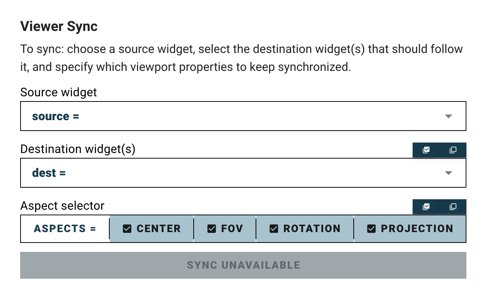

Viewer Sync Plugin
==================

The Viewer Sync plugin synchronizes viewport changes from one source viewer to one or more destination viewers. When the source is panned, zoomed, or otherwise changed, the selected viewport properties are applied to every destination.

Viewer Sync is a :doc:`mast-aladin plugin <plugins>` and uses the plugin framework to discover viewers and display its interface.

|

Supported viewers
-----------------

- `~mast_aladin.app.MastAladin` image viewers
- ``jdaviz`` image viewers

Using the plugin
----------------

To synchronize viewers from the plugin UI:

1. Choose a **source** viewer from the source dropdown. All other viewers follow the source.
2. Select one or more **destination** viewers that should follow the source. The source viewer cannot be selected as a destination.
3. Select which viewport **aspects** (center, field of view, rotation, projection) should be kept synchronized. The selection can be changed while syncing is active.
4. Toggle the **sync** switch to start real-time synchronization. The switch is enabled only once a source and at least one destination have been selected.

When synchronization starts, the destination viewers are immediately aligned to the source, and subsequent changes to the source viewport are propagated to the destinations in real time. Changing the source or destination selection stops the active synchronization.

The dropdown options track the applications registered with the `~mast_aladin.managers.app_manager.AppManager`, so newly created viewers become available in the plugin automatically.

Supported viewport properties
^^^^^^^^^^^^^^^^^^^^^^^^^^^^^

- Center
- Field of view
- Rotation
- Projection

.. note::

    Field of view is the smaller of the viewport width and height.

Limitations with jdaviz viewers
^^^^^^^^^^^^^^^^^^^^^^^^^^^^^^^

- A `jdaviz` application is only available for synchronization once it has an Image viewer and its Orientation plugin has been configured to align by WCS with north up and east to the left (i.e., ``jdaviz.plugins['Orientation'].align_by = 'WCS'``). The plugin configures this automatically, which requires data to be loaded in the jdaviz viewer (i.e., ``jdaviz.load({image}, format='Image')``; until then, the viewer is disabled in the dropdowns. Currently, we only support Image viewers.
- Projection synchronization is not supported in jdaviz: when a jdaviz viewer is a destination, the projection aspect is ignored.
